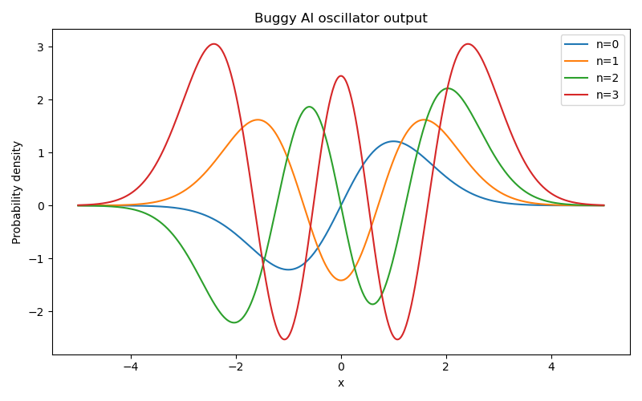
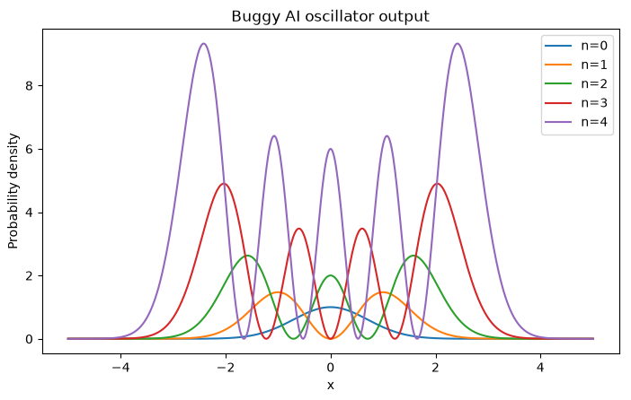

# Week 3 Bug report: AI-generated oscillator

## 1.- Observations (running the original script)

Python version used: 3.11.16

## Initial Error messages shown when running the code for the 1st time:

```
Traceback (most recent call last):
  File "/Users/mayorga/Documents/PhD_UoM/Classes/AI/ai-physics-Aguilar-Mayorga/Hwks/week3/ai_generated_oscillator.py", line 36, in <module>
    main()
  File "/Users/mayorga/Documents/PhD_UoM/Classes/AI/ai-physics-Aguilar-Mayorga/Hwks/week3/ai_generated_oscillator.py", line 20, in main
    states = np.array([harmonic_state(n, x) for n in range(5)])
                      ^^^^^^^^^^^^^^^^^^^^^^^^^^^^^^^^^^^^^^^^
  File "/Users/mayorga/Documents/PhD_UoM/Classes/AI/ai-physics-Aguilar-Mayorga/Hwks/week3/ai_generated_oscillator.py", line 20, in <listcomp>
    states = np.array([harmonic_state(n, x) for n in range(5)])
                       ^^^^^^^^^^^^^^^^^^^^
  File "/Users/mayorga/Documents/PhD_UoM/Classes/AI/ai-physics-Aguilar-Mayorga/Hwks/week3/ai_generated_oscillator.py", line 13, in harmonic_state
    herm = special.hermite_poly(n, x)  # BUG 3
           ^^^^^^^^^^^^^^^^^^^^
AttributeError: module 'scipy.special' has no attribute 'hermite_poly'. Did you mean: 'hermitenorm'?
```

# Debugging process:

## Error 1: (labeled BUG #3)
- a) Based on the previously shown output, I chose to inspect line 13 first. Originally, it was: ```herm = special.hermite_poly(n, x)```

- b) Category: Hallucinated API.

- c) According to SciPy documentation, the plausible real options for this function would've been either ```special.hermite(n) ``` for the Physicist's normalization or ```special.hermitenorm(n)``` for the Probabilist's one. There doesn't seem to be trace of ```special.hermite_poly(n, x)``` having been a previous version, which is what leads me to believe this syntaxis was a hallucination.

- d) The correct options of implementing what was needed could be either:
    ``` 
    herm = special.hermite(n) 
    herm = herm(x) 
    ```
    or, equivalently:
    ``` 
    herm = special.hermite(n)(x) 
    ```
    Based on: https://docs.scipy.org/doc/scipy/reference/generated/scipy.special.hermite.html


## Error 2 (labeled BUG #2):
- a) Located in line 21 as ```states = states[1:] ```

- b) Category: Off by one

- c) The plot that came as a result of the original code, shows clearly 4 levels instead of 5, despite the code's claim to be plotting the 5 energy levels: 

I knew it wasn't that the code wasn't calculating 5 levels because the output in the terminal did show 5 levels:
    ```
    First five E_n: [0. 1. 2. 3. 4.]
    ```

- d)  To plot 5 energy levels instead of 4, the correction should be:
``` states = states[:] ``` since the previous starting point of 1 neglected the fact that Python lists starts counting from 0.


## Error 3 (labeled BUG #1):
- a)  Located at line 9, originally: ```return np.array([hbar * omega * n for n in range(n_levels)])```

- b) Category: wrong physics formula

- c) This incorrect formula would give the wrong values for the energy of the quantum harmonic oscillator. Produces: ```First five E_n: [0. 1. 2. 3. 4.]```

- d) The corrrect formula, as seen in Griffiths' "introduction to Quantum Mechanics", page 35, eq. 2.50, is: ```return np.array([hbar * omega * (n+0.5) for n in range(n_levels)])```

# Error 4 (labeled BUG #5)
- a) Located at line 26, originally ```plt.plot(x, psi, label=f"n={n}")``` 

- b) Category: wrong output quantity

- c) The code is plotting psi on its own, instead of the probability density, which is |psi|**2. It is easy to tell when looking at the graph, since Probability must always be such that P > 0, while the plot shows P having negative values as well.

- d) ```plt.plot(x, np.abs(psi)**2, label = f"n={n}")```. This way we get the actual probability density, defined as |ψ|² = ψ*ψ, as seen in Griffiths' "introduction to Quantum Mechanics."

# Error 5 (labeled BUG #4)
- a) located at line 14, originally: ```norm = 1.0 / np.sqrt(math.factorial(n))```
- b) Category: incorrect normalization.

- c) By inspecting the formula used in the code, we can clearly see the normalization definition is completely wrong. Additionally, when looking at the plot, we can easily realize that the functions are not normalized by the values depicted:

    

 - d)  The correct normalization constant is: ```norm = 1.0 / np.sqrt(2**n * math.factorial(n) * np.sqrt(np.pi))```, as seen in Griffiths' "introduction to Quantum Mechanics", page 41, eq. 2.69


